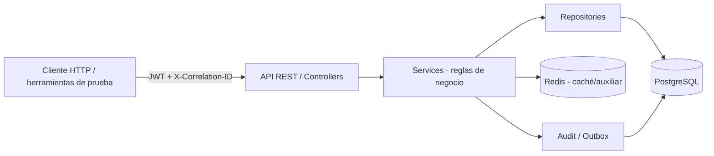
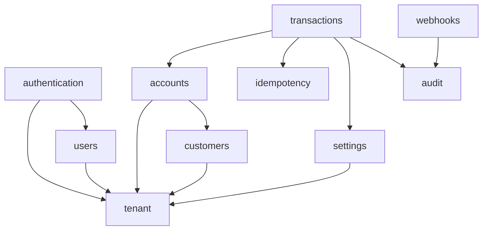

# Visión general de arquitectura

## Estado
- **Implementado:** ninguno. No existe código, configuración ni infraestructura backend en el repositorio.
- **Propuesto:** monolito modular en Java 21 con Spring Boot 3.5.x, API REST JSON, PostgreSQL como fuente de verdad, Redis como apoyo (caché/operaciones auxiliares), seguridad con Spring Security + JWT y aislamiento multitenant.
- **Restricción:** el backend se desarrolla, ejecuta y prueba de forma **independiente** (sin integración con `mobile/`).

## Stack tecnológico (objetivo obligatorio)

| Tecnología | Responsabilidad | Estado |
|---|---|---|
| Java 21 | Lenguaje | No implementado |
| Spring Boot 3.5.x | Framework | No implementado |
| Maven | Build/dependencias | No implementado (`pom.xml` ausente) |
| Spring Security | Seguridad/autorización | No implementado |
| Spring Data JPA / Hibernate | Persistencia/ORM | No implementado |
| Jakarta Validation | Validaciones | No implementado |
| PostgreSQL | Base de datos relacional | No implementado/no configurado |
| Flyway | Migraciones versionadas | No implementado |
| JWT | Autenticación stateless | No implementado |
| Spring Data Redis / Redis | Caché y soporte auxiliar | No implementado |
| Docker / Docker Compose | Contenedores y orquestación local | No implementado |

## Estilo arquitectónico (propuesto)

- **Monolito modular:** un único desplegable con módulos de dominio y límites claros; **no microservicios**.
- **Capas por módulo:** `controller` → `service` → `repository`, con `entity` y `dto` separados.
- **API:** REST JSON bajo prefijo propuesto `/api/v1`.
- **Datos:** PostgreSQL fuente de verdad; transacciones ACID para operaciones financieras.



> Diagrama **propuesto**. Actualmente no existe implementación.

## Estructura de referencia (propuesta)

```text
backend/
├── src/
│   ├── main/
│   │   ├── java/com/bankos/
│   │   │   ├── BankosApplication.java
│   │   │   ├── common/
│   │   │   │   ├── config/
│   │   │   │   ├── security/
│   │   │   │   ├── tenancy/
│   │   │   │   ├── exception/
│   │   │   │   └── response/
│   │   │   └── modules/
│   │   │       ├── tenant/
│   │   │       ├── authentication/
│   │   │       ├── users/
│   │   │       ├── customers/
│   │   │       ├── accounts/
│   │   │       ├── transactions/
│   │   │       ├── idempotency/
│   │   │       ├── settings/
│   │   │       ├── audit/
│   │   │       └── webhooks/
│   │   └── resources/
│   │       ├── application.yml
│   │       └── db/migration/
│   └── test/
├── pom.xml
├── Dockerfile
└── docker-compose.yml
```

**Nota:** si al implementar existe una estructura válida diferente, debe documentarse y mantener coherencia modular.

## Principios transversales (objetivo)

- **Aislamiento multitenant:** toda consulta/mutación de recursos de negocio debe acotarse al `tenant` del contexto autenticado.
- **Seguridad financiera:** `BigDecimal` (Java) y `NUMERIC` (PostgreSQL), operaciones atómicas, control de concurrencia, sin saldos negativos no permitidos, sin eliminación física de movimientos, auditoría.
- **Idempotencia:** operaciones financieras con `Idempotency-Key`; PostgreSQL como fuente de verdad del registro/resultado (Redis solo complementario).
- **Fiabilidad de integraciones:** patrón **Outbox** para webhooks, evitando revertir transacciones financieras confirmadas por fallos externos.
- **Observabilidad:** `X-Correlation-ID` propagado en respuestas y registros.

## Dependencias entre módulos (propuesta, sin ciclos)



> Relaciones **orientativas**; los contratos internos deben evitar dependencias circulares y definirse al implementar.

## Hallazgos de auditoría relevantes

- No hay componentes implementados que validar contra esta arquitectura.
- Cualquier elemento descrito en secciones de módulos, API, seguridad o datos es **propuesto/pendiente** hasta su implementación y verificación.