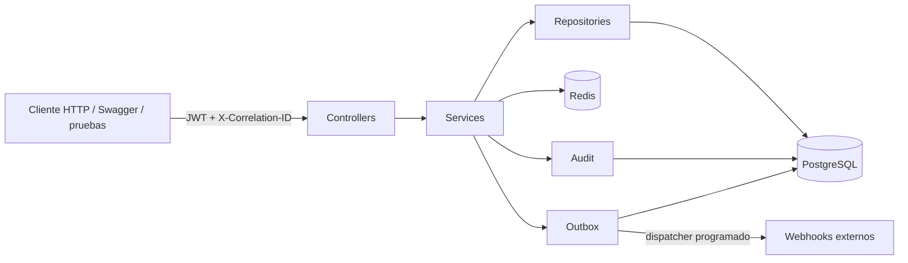

# Visión general de arquitectura del backend

## Estado

- **Implementado:** monolito modular Spring Boot 3.5 / Java 21, API REST `/api/v1`, PostgreSQL 16, Redis 7, Flyway, JWT, idempotencia, auditoría y outbox de webhooks.
- **Ejecutable de forma independiente:** sí, con Docker Compose. No requiere `mobile/`.
- **Fuera de alcance:** integración con Flutter, refresh tokens, RLS, rate limiting, conciliación contable y despliegue productivo.

## Stack

| Tecnología | Responsabilidad | Estado |
|---|---|---|
| Java 21 | Lenguaje | Implementado |
| Spring Boot 3.5.x | Framework | Implementado |
| Maven | Build/dependencias | Implementado (`pom.xml`) |
| Spring Security + Nimbus JWT | Autenticación/autorización | Implementado |
| Spring Data JPA / Hibernate | Persistencia/ORM | Implementado |
| Jakarta Validation | Validaciones | Implementado |
| PostgreSQL 16 | Base de datos transaccional | Implementado |
| Flyway | Migraciones versionadas | Implementado (`V1`–`V6`) |
| Redis 7 | Soporte auxiliar | Implementado |
| Docker / Docker Compose | Infraestructura local | Implementado |
| springdoc OpenAPI | Swagger/OpenAPI | Implementado |

## Estilo arquitectónico

- **Monolito modular:** un único desplegable con módulos de dominio y límites claros.
- **Capas por módulo:** `controller` → `service` → `repository`, con `entity`, `dto` y `mapper` separados.
- **API REST JSON** bajo `/api/v1`.
- **PostgreSQL** es la fuente de verdad; las operaciones financieras son transaccionales y atómicas.



## Estructura implementada

```text
backend/
├── src/main/java/com/bankos/
│   ├── BankOsApplication.java
│   ├── common/
│   │   ├── config/          # seguridad, OpenAPI, scheduling
│   │   ├── security/        # JWT, filtros, principal
│   │   ├── tenancy/         # TenantContext
│   │   ├── exception/       # ApiException, ErrorCode, handler
│   │   ├── response/        # ApiResponse, PageResponse
│   │   ├── money/           # MoneyUtils
│   │   └── web/             # correlation ID
│   └── modules/
│       ├── auth/
│       ├── tenants/
│       ├── users/
│       ├── customers/
│       ├── accounts/
│       ├── settings/
│       ├── idempotency/
│       ├── transactions/
│       ├── audit/
│       └── webhooks/
├── src/main/resources/
│   ├── application.yml
│   ├── application-dev.yml
│   ├── application-test.yml
│   ├── application-prod.yml
│   └── db/
│       ├── migration/       # V1–V6
│       └── dev/             # V100 seed demo
├── src/test/java/           # unitarias + integración Testcontainers
├── Dockerfile
├── docker-compose.yml
└── pom.xml
```

## Modelo multi-banco

- Cada institución es un **tenant**.
- Cada usuario pertenece a **un** tenant y se autentica con `tenant_code + email + password`.
- El JWT incluye `tenant_id`, `email` y `roles`.
- El cliente puede guardar un token por institución y cambiar de sesión sin volver a autenticarse.
- `PLATFORM_ADMIN` pertenece al tenant reservado `PLATFORM`.
- Roles: `PLATFORM_ADMIN`, `TENANT_ADMIN`, `OPERATOR`, `AUDITOR`.

## Seguridad y aislamiento

- Spring Security OAuth2 Resource Server con JWT HS256.
- BCrypt con strength 12.
- `TenantContext` se llena desde el JWT; el `tenant_id` **nunca** se acepta del cuerpo o query params.
- Repositorios y servicios filtran explícitamente por tenant.
- Acceso cruzado responde `404` para no revelar la existencia del recurso.
- CORS configurable por `CORS_ALLOWED_ORIGINS`.

## Consistencia financiera

- Importes en `BigDecimal` y `NUMERIC(19,4)`; tasas `NUMERIC(19,8)`.
- Redondeo `HALF_UP` y escala 4 en `MoneyUtils`.
- Bloqueo pesimista (`PESSIMISTIC_WRITE`) de cuentas al operar.
- `CHECK (balance >= 0)` y sin sobregiro en el MVP.
- Movimientos contables en `transaction_entries`; no se eliminan físicamente.
- Operaciones: depósito, retiro, transferencia y preview de transferencia.

## Idempotencia

- Header obligatorio `Idempotency-Key` en operaciones financieras.
- Clave única `(tenant_id, operation, idempotency_key)`.
- Hash del cuerpo y snapshot de la respuesta.
- Advisory lock de PostgreSQL para serializar solicitudes concurrentes.
- Mismo cuerpo + misma llave → replay de la respuesta original.
- Cuerpo distinto + misma llave → `409 IDEMPOTENCY_CONFLICT`.

## Auditoría y webhooks

- `audit_logs` registra actor, tenant, acción, entidad, datos y correlation ID.
- Webhooks usan patrón **outbox** en PostgreSQL.
- Un dispatcher programado dentro de la misma aplicación envía eventos y controla reintentos.
- No se revierte una transacción financiera confirmada por fallos de webhooks.

## Datos y migraciones

- Flyway es la única fuente del esquema; Hibernate usa `ddl-auto=validate`.
- Migraciones `V1`–`V6` para todos los perfiles.
- `V100__dev_seed.sql` solo en perfil `dev` con Nequi, Daviplata, PayPal, Bancolombia, NU, Banco Horizonte y Platform.
- Índices y constraints por `tenant_id`.

## Despliegue local

```bash
cd backend
cp .env.example .env
docker compose up --build
```

Servicios: `backend` (8080), `postgres` (5432 interno) y `redis` (6379). Si el host ya usa `5432`, ejecutar con `DB_PORT=55432`.

## Pendientes arquitectónicos

- Refresh tokens, rotación de secretos y revocación de sesiones.
- Rate limiting y bloqueo por intentos fallidos.
- RLS de PostgreSQL y claves Redis con prefijo de tenant.
- Worker de webhooks separado y cola durable.
- Reconciliación contable, cierre diario y reportes.
- CI/CD, Maven Wrapper, métricas, trazas y alertas.
- Integración futura con `mobile/`.

## Documentación relacionada

- [Plan de implementación](../implementation-plan.md)
- [API](../api/api-overview.md)
- [Autenticación](../security/authentication.md)
- [Multitenancy](../security/multitenancy.md)
- [Docker](../infrastructure/docker-setup.md)
- [Modelo multi-banco](../../../docs/architecture/multi-bank-model.md)
