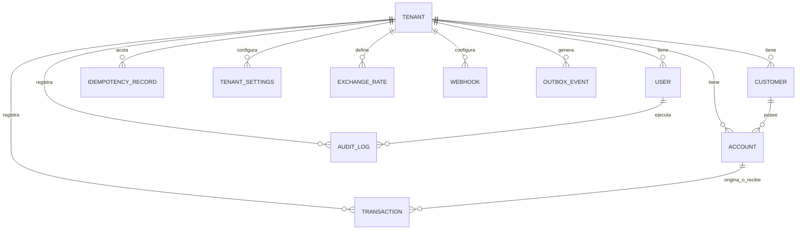

# Diseño de base de datos

## Estado
- **Implementado:** ninguno. No existen migraciones Flyway, scripts SQL, entidades JPA ni configuración de conexión a PostgreSQL en el repositorio.
- **Propuesto:** PostgreSQL como base relacional, esquema multitenant con `tenant_id`, migraciones versionadas con Flyway e integridad referencial.
- **No verificable:** índices reales, planes de ejecución, bloqueos en runtime y desempeño (sin esquema/ejecución).

## Principios de diseño (propuestos)

- **Multitenancy:** tablas de negocio incluyen `tenant_id` (FK a `tenant`) y todas las consultas se filtran por tenant desde el contexto autenticado.
- **Tipos financieros:** importes con `NUMERIC(p,s)` en BD y `BigDecimal` en Java; **nunca** `float`/`double`.
- **Integridad:** claves primarias, foráneas, restricciones `NOT NULL`, `UNIQUE`, `CHECK` y estados controlados.
- **Inmutabilidad operativa:** no eliminación física de movimientos financieros; correcciones mediante operaciones/ajustes trazables.
- **Concurrencia:** operaciones financieras en transacciones ACID con bloqueos apropiados (p. ej. `SELECT ... FOR UPDATE` sobre cuentas afectadas, a definir).
- **Auditoría y trazabilidad:** registro de acciones/eventos y correlación.

## Entidades y modelo lógico (propuesto)

> Campos, tipos y nombres son una **propuesta inicial**; deben ajustarse a requisitos confirmados antes de crear migraciones.

| Entidad | Propósito | Campos principales (propuestos) | Relaciones / restricciones | Índices recomendados |
|---|---|---|---|---|
| **Tenant** | Institución/organización | `id` (PK), `name`, `code`/`slug`, `status`, `created_at`, `updated_at` | Raíz del aislamiento | `UNIQUE(code/slug)` |
| **User** | Usuario del sistema por tenant | `id` (PK), `tenant_id` (FK), `username`/`email`, `password_hash`, `status`, `created_at`, `updated_at` | FK `tenant`; único por tenant | `UNIQUE(tenant_id,email)` , `INDEX(tenant_id)` |
| **Role** | Roles y/o permisos | `id` (PK), `tenant_id` (FK, si es por tenant) o global, `name`, `permissions`/`scope` | N:N con `User` (tabla intermedia propuesta) | `UNIQUE(tenant_id,name)` |
| **Customer** | Cliente final de la institución | `id` (PK), `tenant_id` (FK), `document_type`, `document_number`, `full_name`, `status`, `created_at` | FK `tenant`; único por tenant | `UNIQUE(tenant_id,document_number)` , `INDEX(tenant_id)` |
| **Account** | Cuenta bancaria | `id` (PK), `tenant_id` (FK), `customer_id` (FK), `account_number`, `currency`, `balance NUMERIC`, `available_balance NUMERIC` (opcional), `status`, `version` (optimista, opcional), `created_at` | FK `tenant`, `customer`; saldo coherente | `UNIQUE(tenant_id,account_number)` , `INDEX(tenant_id,customer_id)` , `INDEX(tenant_id,status)` |
| **Transaction** | Operación/movimiento financiero | `id` (PK), `tenant_id` (FK), `type` (DEPOSIT/WITHDRAWAL/TRANSFER), `status`, `amount NUMERIC`, `currency`, `fee NUMERIC`, `exchange_rate NUMERIC` (si aplica), `source_account_id` (FK), `destination_account_id` (FK), `reference`, `created_at` | FK `tenant`, cuentas; integridad por tipo | `INDEX(tenant_id,created_at)` , `INDEX(tenant_id,source_account_id)` , `INDEX(tenant_id,destination_account_id)` |
| **IdempotencyRecord** | Clave y resultado de operación idempotente | `id` (PK), `tenant_id` (FK), `idempotency_key`, `operation`, `request_hash`, `response_payload`/`status`, `resource_id`, `status` (IN_PROGRESS/COMPLETED/FAILED), `created_at`, `expires_at` | Única por tenant+clave (+operación, a definir) | `UNIQUE(tenant_id,idempotency_key,operation)` |
| **TenantSettings** | Configuración por tenant | `id` (PK), `tenant_id` (FK), `key`/config, `value`, `updated_at` | FK `tenant` | `UNIQUE(tenant_id,key)` o 1:1 según diseño |
| **ExchangeRate** | Tasas de cambio por tenant | `id` (PK), `tenant_id` (FK), `from_currency`, `to_currency`, `rate NUMERIC`, `effective_from`, `effective_to`/`active`, `created_at` | FK `tenant`; vigencia | `INDEX(tenant_id,from_currency,to_currency,effective_from)` |
| **AuditLog** | Trazabilidad de acciones | `id` (PK), `tenant_id` (FK), `actor_user_id`, `action`, `resource_type`, `resource_id`, `metadata` (JSONB), `correlation_id`, `created_at` | FK `tenant` | `INDEX(tenant_id,created_at)` , `INDEX(correlation_id)` |
| **Webhook** | Configuración de endpoints externos | `id` (PK), `tenant_id` (FK), `url`, `events`, `secret`/firma, `status`, `created_at` | FK `tenant` | `INDEX(tenant_id,status)` |
| **OutboxEvent** | Eventos pendientes/enviados (patrón Outbox) | `id` (PK), `tenant_id` (FK), `aggregate_type`, `aggregate_id`, `event_type`, `payload` (JSONB), `status`, `attempts`, `next_retry_at`, `created_at`, `processed_at` | Persistido en misma transacción de negocio | `INDEX(status,next_retry_at)` , `INDEX(tenant_id,created_at)` |

## Diagrama entidad-relación (propuesto)

## Migraciones (Flyway) — propuesto
- Ubicación: `backend/src/main/resources/db/migration/` (p. ej. `V1__init_schema.sql`).
- Versionado incremental, repetible solo cuando aplique (`R__`), y sin edición de migraciones aplicadas.
- **Estado:** no hay migraciones en el repositorio.

## Consideraciones de concurrencia y consistencia (propuestas)
- Transferencias y movimientos de saldo: transacción única con bloqueos de fila sobre cuentas involucradas en orden determinista (para reducir deadlocks).
- Validar saldo y estado de cuenta dentro de la misma transacción.
- Usar restricciones `CHECK` (p. ej. saldo >= 0 si no se permite descubierto) según política confirmada.
- `IdempotencyRecord`: restricción única para evitar duplicados concurrentes; manejo de estado `IN_PROGRESS` para solicitudes simultáneas.

## Decisiones pendientes
- Precisión/escala `NUMERIC` (p. ej. 19,4 / 19,6) y reglas de redondeo.
- Política de descubierto (saldos negativos) y cuentas multidivisa.
- Modelado exacto de roles/permisos (RBAC) y relación usuario-rol.
- Estrategia de particionado/retención para `audit_log` y `outbox_event` (volumen futuro).