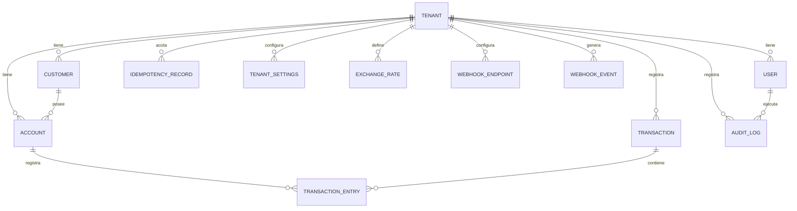

# Diseño de base de datos

## Estado

- **Implementado:** PostgreSQL 16 con Flyway (`V1`–`V6`), entidades JPA, datasource configurado y seed demo `V100` para el perfil `dev`.
- **Aislamiento:** `tenant_id` en datos de negocio y filtrado explícito en repositorios/servicios.
- **Sin RLS:** el MVP usa aislamiento lógico; RLS queda en el backlog.

## Principios

- **Multitenancy:** tablas de negocio incluyen `tenant_id` y todas las consultas se filtran por el tenant autenticado.
- **Tipos financieros:** `NUMERIC(19,4)` para importes y `NUMERIC(19,8)` para tasas; `BigDecimal` en Java. Nunca `float`/`double`.
- **Integridad:** PK, FK, `NOT NULL`, `UNIQUE`, `CHECK` e índices.
- **Inmutabilidad operativa:** no se eliminan físicamente movimientos financieros.
- **Concurrencia:** transacciones ACID y bloqueos pesimistas sobre cuentas.
- **Auditoría:** `audit_logs` y outbox en la misma transacción de negocio.

## Entidades implementadas

| Entidad/Tabla | Propósito | Campos/restricciones principales |
|---|---|---|
| `tenants` | Institución | `id`, `code` único, `name`, branding, `status` |
| `users` | Usuario por tenant | `tenant_id`, `email`, `password_hash`, `role`, `status`; único `(tenant_id,email)` |
| `customers` | Cliente final | `tenant_id`, documento, nombre, estado; único por tenant |
| `accounts` | Cuenta | `tenant_id`, `customer_id`, `account_number`, `currency`, `balance NUMERIC(19,4)`, `status`; `CHECK (balance >= 0)` |
| `transactions` | Cabecera financiera | `tenant_id`, tipo, estado, importe, moneda, comisión, tasa, cuentas origen/destino |
| `transaction_entries` | Movimientos contables | Cuenta, débito/crédito, moneda, importe; permiten reconstruir saldos |
| `idempotency_records` | Idempotencia | Único `(tenant_id, operation, idempotency_key)`, hash y snapshot de respuesta |
| `tenant_settings` | Configuración | Clave/valor por tenant |
| `exchange_rates` | Tasas | Par de monedas, tasa `NUMERIC(19,8)`, vigencia |
| `audit_logs` | Auditoría | Actor, tenant, acción, entidad, payload, correlation ID |
| `webhook_endpoints` | Destinos | URL, eventos, secreto, estado |
| `webhook_events` | Outbox | Evento, payload, estado, intentos, próxima reintento |

## Diagrama entidad-relación

## Migraciones Flyway

Ubicación: `backend/src/main/resources/db/migration/`.

- `V1`–`V6`: esquema completo para todos los perfiles.
- `V100__dev_seed.sql`: solo `db/dev` y perfil `dev`.
- Migraciones inmutables una vez aplicadas.
- `ddl-auto=validate`; Flyway es la única fuente del esquema.

## Concurrencia y consistencia

- Transferencias y movimientos de saldo en una única transacción.
- Bloqueo `PESSIMISTIC_WRITE` sobre cuentas involucradas.
- Orden determinista de bloqueo para reducir deadlocks.
- Validación de saldo y estado dentro de la transacción.
- Idempotencia con advisory lock y restricción única.

## Decisiones implementadas

- Precisión/escala: `NUMERIC(19,4)` y `NUMERIC(19,8)`.
- Sin descubierto en el MVP (`balance >= 0`).
- Roles como enum (`PLATFORM_ADMIN`, `TENANT_ADMIN`, `OPERATOR`, `AUDITOR`), sin tabla N:N.
- Retención/particionado: pendiente.

## Pendiente

- RLS de PostgreSQL.
- Particionado/retención de auditoría y outbox.
- Conciliación contable y cierre diario.
- Cifrado de columnas sensibles.
- Planes de ejecución y tuning con datos reales.
