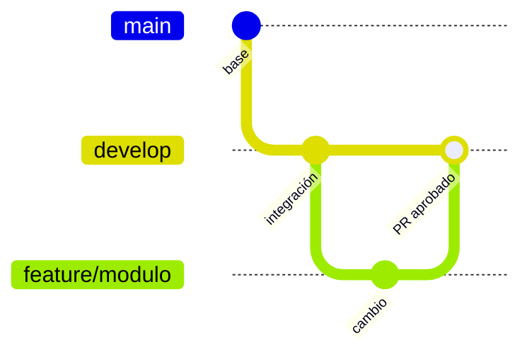

# Flujo de trabajo Git

## Estado
- **Implementado (auditado en repo local):** repositorio Git inicializado con rama `master` y sin commits al momento de la auditoría; existe `.github/pull_request_template.md`.
- **No verificable desde el repositorio:** protecciones de rama en GitHub, configuración de revisores obligatorios y políticas remotas.
- **Propuesto:** flujo basado en ramas de integración y Pull Requests.

## Modelo de ramas (propuesto)

| Rama | Propósito | Regla |
|---|---|---|
| `main` | Versiones estables / entregables | Sin commits directos |
| `develop` | Integración continua del equipo | Sin commits directos |
| `feature/*` | Nuevas funcionalidades | PR hacia `develop` |
| `fix/*` | Correcciones de errores | PR hacia `develop` |
| `refactor/*` | Refactorizaciones sin cambio funcional | PR hacia `develop` |
| `docs/*` | Cambios de documentación | PR hacia `develop` |
| `test/*` | Incorporación/mejora de pruebas | PR hacia `develop` |

## Flujo recomendado

1. Actualizar rama base: `develop`.
2. Crear rama de trabajo: `git checkout -b feature/<nombre-corto>`.
3. Realizar cambios atómicos y commits con **Conventional Commits**.
4. Ejecutar build/pruebas localmente cuando existan (pendiente hoy en backend).
5. Abrir Pull Request hacia `develop` con descripción, alcance y evidencia.
6. Obtener revisión y aprobación de al menos otro integrante.
7. Resolver conversaciones y fusionar según política acordada.

> Diagrama ilustrativo del flujo **propuesto**.

## Conventional Commits

| Tipo | Uso | Ejemplo |
|---|---|---|
| `feat` | Nueva funcionalidad | `feat: implement tenant registration endpoint` |
| `fix` | Corrección | `fix: validate account status before withdrawal` |
| `refactor` | Reestructuración interna | `refactor: extract transfer calculation service` |
| `docs` | Documentación | `docs: add backend database design` |
| `test` | Pruebas | `test: add idempotency concurrency cases` |
| `chore` | Mantenimiento | `chore: update maven wrapper` |

## Pull Requests (propuesto)

- **Destino:** `develop` (salvo hotfixes definidos por el equipo).
- **Revisión:** al menos 1 aprobación de otro integrante; **prohibido autoaprobar**.
- **Contenido mínimo:** problema, solución, módulos afectados, evidencia de pruebas, efectos secundarios y checklist.
- **Calidad:** conversaciones resueltas, sin secretos en diffs, sin cambios fuera de alcance (p. ej. no tocar `mobile/` en tareas de backend).

## Buenas prácticas
- Commits pequeños y coherentes; mensajes en imperativo y claros.
- No mezclar refactors masivos con cambios funcionales sin justificación.
- Mantener documentación alineada con cambios de comportamiento/contratos.
- Para backend: evidenciar validaciones de seguridad financiera y aislamiento multitenant cuando aplique.

## Inconsistencias/pendientes detectados
- No existe rama `develop` en el estado local auditado.
- No hay historial de commits; se recomienda establecer commit base y estrategia de ramas acordada por el equipo.
- Configurar y verificar Branch Protection Rules en el repositorio remoto (fuera del alcance de esta auditoría).