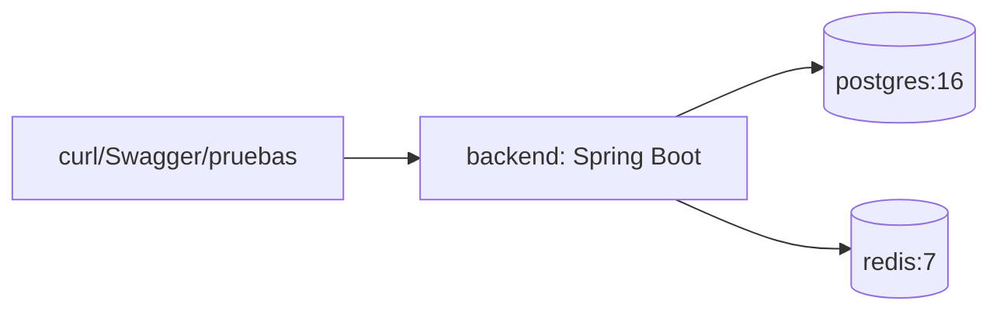

# Configuración Docker e infraestructura

## Estado

- **Implementado:** `Dockerfile` multi-stage, `docker-compose.yml`, `.env.example`, healthchecks y ejecución como usuario no root.
- **Servicios:** backend Spring Boot, PostgreSQL 16 y Redis 7.
- **Pendiente:** despliegue productivo, orquestación (Kubernetes/ECS), secretos gestionados y worker separado de webhooks.

## Objetivo

Permitir que el backend se construya, ejecute y verifique **por sí solo**, sin depender de `mobile/`.

## Servicios

| Servicio | Imagen/Build | Puerto por defecto | Propósito |
|---|---|---|---|
| `backend` | Build `backend/Dockerfile` | `8080` | API Spring Boot |
| `postgres` | `postgres:16-alpine` | `5432` | Base de datos principal |
| `redis` | `redis:7-alpine` | `6379` | Caché/soporte auxiliar |



## Ejecución

```bash
cd backend
cp .env.example .env
docker compose up --build
```

> Si el puerto `5432` está ocupado, ejecuta `DB_PORT=55432 docker compose up --build`. `DB_PORT` solo cambia el puerto publicado en el host; el backend usa `postgres:5432` dentro de la red de Compose.

- API: `http://localhost:8080`
- Swagger UI: `http://localhost:8080/swagger-ui.html`
- Health: `http://localhost:8080/actuator/health`
- El perfil `dev` carga el seed de demostración.

## Dockerfile

- Etapa `build`: `maven:3.9-eclipse-temurin-21`, `mvn -B -Dmaven.test.skip=true package`, con caché BuildKit para `/root/.m2`.
- Etapa runtime: `eclipse-temurin:21-jre-alpine`.
- Usuario no root `bankos`.
- `HEALTHCHECK` contra `/actuator/health`.
- `-XX:MaxRAMPercentage=75.0`.

## Variables de entorno

| Variable | Descripción | Default Compose |
|---|---|---|
| `SPRING_PROFILES_ACTIVE` | Perfil (`dev`, `test`, `prod`) | `dev` |
| `APP_PORT` | Puerto de la API | `8080` |
| `DB_NAME` | Base de datos | `bankos` |
| `DB_USERNAME` | Usuario PostgreSQL | `bankos` |
| `DB_PASSWORD` | Password PostgreSQL | `bankos` |
| `DB_PORT` | Puerto PostgreSQL | `5432` |
| `REDIS_HOST` / `REDIS_PORT` | Conexión Redis | `redis` / `6379` |
| `JWT_SECRET` | Secreto HS256 | valor ficticio; **cambiar** |
| `JWT_ISSUER` | Emisor JWT | `bankos` |
| `JWT_EXPIRATION_MS` | Expiración access token | `3600000` |
| `CORS_ALLOWED_ORIGINS` | Orígenes permitidos | localhost |
| `WEBHOOK_DISPATCH_INTERVAL_MS` | Intervalo del dispatcher | `5000` |
| `WEBHOOK_MAX_ATTEMPTS` | Intentos máximos | `8` |
| `WEBHOOK_TIMEOUT_MS` | Timeout HTTP | `5000` |

**Nunca** commitear `.env` real ni secretos. `.env.example` solo contiene valores ficticios.

## Perfiles

- `dev`: logs de desarrollo y seed `db/dev/V100__dev_seed.sql`.
- `test`: solo migraciones `db/migration`; scheduling deshabilitado; Testcontainers.
- `prod`: sin seed, `ddl-auto=validate`, secretos obligatorios por entorno.

## Healthchecks

- PostgreSQL: `pg_isready`.
- Redis: `redis-cli ping`.
- Backend: `wget -qO- http://localhost:8080/actuator/health`.
- Compose espera `service_healthy` antes de arrancar el backend.

## Persistencia

- Volumen `bankos-postgres` para datos.
- Para reiniciar limpio: `docker compose down -v` (elimina la base).

## Producción (pendiente)

- TLS en proxy inverso.
- Secretos en gestor dedicado.
- Escalar el dispatcher de webhooks fuera de la API.
- Backups, métricas, alertas y trazas.
