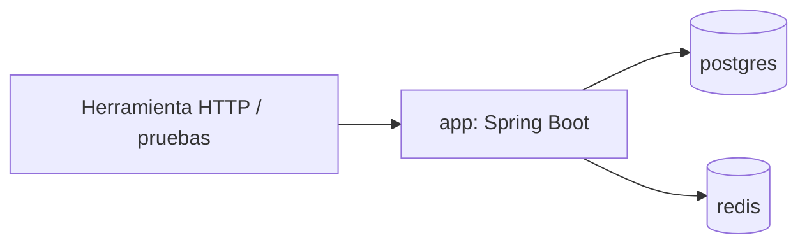

# Configuración Docker e infraestructura

## Estado
- **Implementado:** ninguno. No existen `Dockerfile`, `docker-compose.yml`, `.env.example` ni configuración de contenedores en el repositorio.
- **Propuesto:** ejecución independiente del backend con Docker Compose (Spring Boot + PostgreSQL + Redis), configurable por variables de entorno y sin secretos reales en el repositorio.

## Objetivo
Permitir que el backend se construya, ejecute y verifique **por sí solo**, sin depender de `mobile/` ni de servicios del frontend.

## Servicios (propuestos)

| Servicio | Imagen/Build | Propósito | Estado |
|---|---|---|---|
| `app` | Build desde `backend/Dockerfile` (o imagen Maven/JDK) | API Spring Boot | Pendiente |
| `postgres` | `postgres` (versión a definir) | Base de datos principal | Pendiente |
| `redis` | `redis` (versión a definir) | Caché y soporte auxiliar | Pendiente |



## Ejemplo de `docker-compose.yml` (propuesto, no implementado)

```yaml
services:
  postgres:
    image: postgres:16
    environment:
      POSTGRES_DB: ${POSTGRES_DB}
      POSTGRES_USER: ${POSTGRES_USER}
      POSTGRES_PASSWORD: ${POSTGRES_PASSWORD}
    ports:
      - "${POSTGRES_PORT:-5432}:5432"
    volumes:
      - postgres_data:/var/lib/postgresql/data
    healthcheck:
      test: ["CMD-SHELL", "pg_isready -U ${POSTGRES_USER} -d ${POSTGRES_DB}"]
      interval: 10s
      timeout: 5s
      retries: 5

  redis:
    image: redis:7
    ports:
      - "${REDIS_PORT:-6379}:6379"
    healthcheck:
      test: ["CMD", "redis-cli", "ping"]
      interval: 10s
      timeout: 5s
      retries: 5

  app:
    build:
      context: .
      dockerfile: Dockerfile
    environment:
      SPRING_PROFILES_ACTIVE: ${SPRING_PROFILES_ACTIVE:-dev}
      DB_URL: jdbc:postgresql://postgres:5432/${POSTGRES_DB}
      DB_USERNAME: ${POSTGRES_USER}
      DB_PASSWORD: ${POSTGRES_PASSWORD}
      REDIS_HOST: redis
      REDIS_PORT: 6379
      JWT_SECRET: ${JWT_SECRET}
    ports:
      - "${APP_PORT:-8080}:8080"
    depends_on:
      postgres:
        condition: service_healthy
      redis:
        condition: service_healthy

volumes:
  postgres_data:
```

## Variables de entorno (propuestas)

| Variable | Descripción | Ejemplo/nota |
|---|---|---|
| `SPRING_PROFILES_ACTIVE` | Perfil activo (`dev`, `test`, `prod`) | `dev` |
| `APP_PORT` | Puerto expuesto de la API | `8080` |
| `DB_URL` / `POSTGRES_DB` / `POSTGRES_USER` / `POSTGRES_PASSWORD` | Conexión a PostgreSQL | Sin secretos en git |
| `REDIS_HOST` / `REDIS_PORT` | Conexión a Redis | `redis`, `6379` en Compose |
| `JWT_SECRET` | Secreto/clave para JWT | **Solo en entorno**, fuerte y rotatable |
| `JWT_EXPIRATION` | Expiración de tokens | Definir unidad/formato |

- Proveer `.env.example` con claves y valores ficticios/documentados; `.env` real debe estar ignorado por git.
- **Nunca** incluir credenciales, secretos ni tokens reales en el repositorio.

## Dockerfile (propuesto, no implementado)
- Build multi-stage (Maven build + JRE runtime) recomendado para imagen liviana.
- Ejecutar como usuario no root.
- Exponer puerto de la aplicación y configurar healthcheck cuando sea viable.

## Perfiles y ejecución local
- `dev`: desarrollo local con logs detallados y dependencias locales (Compose).
- `test`: orientado a pruebas (Testcontainers o servicios efímeros, a definir).
- `prod`: configuración endurecida, sin valores por defecto inseguros.

## Healthchecks y observabilidad (propuesto)
- Healthchecks en `postgres` y `redis` para orden de arranque (`depends_on` con condición).
- Endpoint de salud de Spring Boot Actuator (si se incluye, decisión pendiente) para verificar estado de la app y dependencias.

## Consideraciones
- Los volúmenes persisten datos de PostgreSQL entre reinicios; definir estrategia de limpieza para entornos de prueba.
- Redis complementa pero no reemplaza a PostgreSQL como fuente de verdad (especialmente para idempotencia/finanzas).
- No incluir servicios ni configuración relacionados con Flutter/`mobile/`.