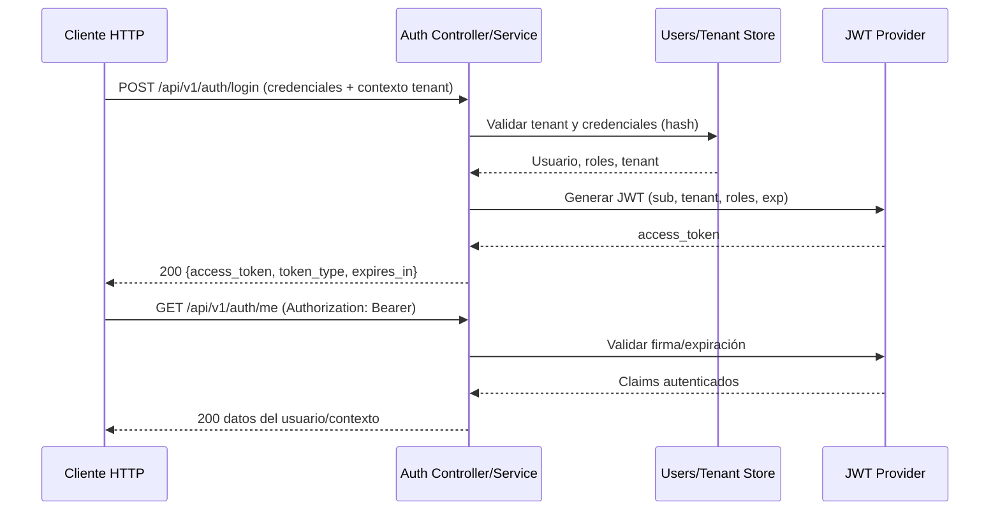

# Autenticación

## Estado
- **Implementado:** ninguno. No existe Spring Security, filtros JWT, endpoints de autenticación ni gestión de credenciales en el backend.
- **Propuesto:** autenticación stateless mediante JWT, credenciales validadas en backend y autorización basada en roles/permisos.

## Objetivos (propuestos)
- Verificar identidad de usuarios por tenant.
- Emitir y validar JWT con información mínima necesaria: identidad de usuario, `tenant_id`, roles y expiración.
- Proteger endpoints mediante Spring Security y reglas de autorización.
- Almacenar contraseñas con **hashing seguro** (p. ej. BCrypt o Argon2, a definir), nunca en texto plano.

## Flujo de autenticación (propuesto)

## JWT (propuesto)

### Claims esperados
- `sub` / identificador de usuario.
- `tenant_id` (o claim equivalente) — **origen de confianza** para el aislamiento.
- `roles` / autoridades.
- `iat`, `exp` (y opcional `jti` para revocación/seguimiento).

### Reglas
- Firmar con secreto/clave robusta inyectada por entorno (`JWT_SECRET`/par de claves), **nunca** hardcodeada ni commiteada.
- Validar firma, expiración, emisor/audiencia (si se definen) y presencia de tenant.
- Rechazar tokens inválidos, expirados o mal formados con `401`.
- Tiempo de expiración configurable; estrategia de refresh tokens **pendiente** de definición.

## Endpoints (propuestos)

| Método | Endpoint | Descripción | Estado |
|---|---|---|---|
| POST | `/api/v1/auth/login` | Autentica y retorna JWT | Pendiente |
| GET | `/api/v1/auth/me` | Retorna identidad y contexto del token | Pendiente |

## Autorización (propuesta)
- Spring Security con filtro de autenticación JWT antes de la autorización.
- Reglas por endpoint y por rol (RBAC), con denegación por defecto en recursos protegidos.
- Validaciones adicionales en servicio para pertenencia de recursos al tenant.

## Consideraciones de seguridad
- No exponer si el usuario existe de forma que facilite enumeración (mensajes genéricos en fallos de login, según política).
- Proteger contra fuerza bruta/rate limiting (pendiente de diseño/infra).
- Registrar eventos de autenticación relevantes en auditoría (pendiente).
- Cerrar sesión / revocación: diseño pendiente (lista de denegación, versión de token o TTL corto).

## Relación con multitenancy
- El tenant se deriva del **JWT/contexto autenticado**, no de parámetros arbitrarios del cliente.
- Ver [Multitenancy](multitenancy.md).

## Estado de verificación
Sin implementación ni pruebas; controles de autenticación **no verificables** actualmente.