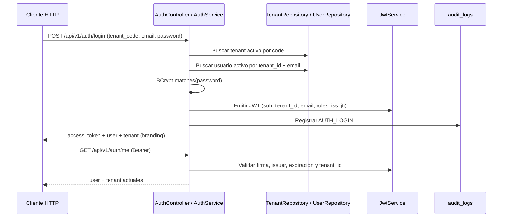

# Autenticación

## Estado

- **Implementado:** Spring Security, JWT HS256, login por institución, `/auth/me`, BCrypt strength 12, RBAC y auditoría de login.
- **Pendiente:** refresh tokens, revocación centralizada, rotación de secretos, rate limiting y bloqueo por intentos fallidos.

## Modelo multi-banco (Opción A)

Cada usuario pertenece a una institución (tenant). El login se hace **una vez por banco**:

```http
POST /api/v1/auth/login
Content-Type: application/json

{
  "tenant_code": "BANCO_HORIZONTE",
  "email": "admin@horizonte.com",
  "password": "Admin123!"
}
```

La app puede guardar un token por `tenant_code` y cambiar de institución sin volver a autenticarse. El backend no mantiene una sesión global ni una tabla de sesiones en el MVP: cada JWT representa una sesión independiente atada a su tenant.

Ver [Modelo multi-banco](../../../docs/architecture/multi-bank-model.md).

## Flujo implementado



## JWT

### Claims

| Claim | Uso |
|---|---|
| `sub` | ID del usuario (`users.id`). |
| `tenant_id` | Tenant del usuario. **Fuente de verdad** para el aislamiento. |
| `email` | Email del usuario. |
| `roles` | Lista de roles: `PLATFORM_ADMIN`, `TENANT_ADMIN`, `OPERATOR`, `AUDITOR`. |
| `iss` | Emisor configurado (`app.jwt.issuer`, por defecto `bankos`). |
| `jti` | Identificador único del token. |
| `iat`, `exp` | Emisión y expiración. |

### Reglas

- Firma HS256 con `JWT_SECRET` inyectado por entorno. Mínimo recomendado: 32 bytes aleatorios.
- El validador exige `tenant_id` no vacío y `iss` correcto.
- Tokens inválidos o expirados devuelven `401 UNAUTHORIZED` con el sobre de error.
- La expiración se configura con `JWT_EXPIRATION_MS` (por defecto 1 hora).
- No hay refresh token en el MVP; al expirar, el cliente debe volver a hacer login para ese banco.

## Endpoints

| Método | Endpoint | Descripción | Auth | Estado |
|---|---|---|---|---|
| `POST` | `/api/v1/auth/login` | Autentica por institución y retorna JWT | Público | Implementado |
| `GET` | `/api/v1/auth/me` | Retorna usuario y tenant del token | Bearer | Implementado |

## Autorización

- `SecurityConfig` configura OAuth2 Resource Server con `JwtDecoder` Nimbus.
- `TenantContextFilter` corre después de `BearerTokenAuthenticationFilter` y publica `tenant_id`, `user_id` y roles en `TenantContext`.
- Reglas por endpoint con `@PreAuthorize` y roles:
  - `PLATFORM_ADMIN`: crear instituciones, acceso de plataforma.
  - `TENANT_ADMIN`: administración del tenant.
  - `OPERATOR`: clientes, cuentas y operaciones financieras.
  - `AUDITOR`: lectura de historial, auditoría y webhooks.
- Además del rol, los servicios validan pertenencia del recurso al tenant.

## Contraseñas

- Hash BCrypt con strength 12.
- Nunca se devuelve `password_hash` en respuestas.
- El seed demo usa `Admin123!` solo para desarrollo.

## Consideraciones de seguridad

- Mensaje genérico `INVALID_CREDENTIALS` para tenant, usuario o contraseña incorrectos.
- Login exitoso auditado en `audit_logs` con `correlation_id`.
- **Pendiente:** rate limiting, bloqueo por intentos fallidos, refresh tokens, revocación y MFA.
- **Pendiente:** rotación de `JWT_SECRET` sin invalidar todas las sesiones.

## Verificación

- Prueba de integración: login real, depósito autenticado, replay idempotente y aislamiento entre tenants.
- Ver [TransactionApiIntegrationTest](../../src/test/java/com/bankos/integration/TransactionApiIntegrationTest.java).
