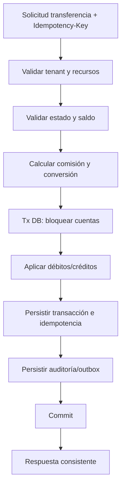
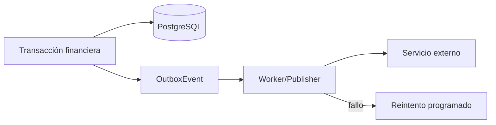

# Seguridad financiera

## Estado
- **Implementado:** ninguno. No hay lógica financiera, modelo de datos ni transacciones en el backend.
- **Propuesto/Obligatorio:** controles de precisión, atomicidad, concurrencia, idempotencia, auditoría e inmutabilidad de movimientos.
- **No verificable:** cumplimiento de reglas monetarias y consistencia transaccional (sin implementación).

## Reglas obligatorias

| Regla | Aplicación | Estado |
|---|---|---|
| Precisión monetaria | `BigDecimal` en Java, `NUMERIC(p,s)` en PostgreSQL | Pendiente |
| Prohibición de flotantes | Nunca `float`/`double` para dinero | Pendiente |
| Atomicidad | Operaciones financieras en transacciones ACID | Pendiente |
| Concurrencia | Bloqueos apropiados (p. ej. fila/cuenta) y orden determinista | Pendiente |
| Saldo válido | Evitar saldos negativos cuando no estén permitidos | Pendiente (política a confirmar) |
| Inmutabilidad | No eliminar físicamente movimientos financieros | Pendiente |
| Auditoría | Registrar operaciones y acciones relevantes | Pendiente |
| Idempotencia | `Idempotency-Key` con registro persistente (PostgreSQL fuente de verdad) | Pendiente |
| Aislamiento tenant | Validar pertenencia de cuentas/recursos al tenant autenticado | Pendiente |

## Flujo de transferencia (propuesto)

1. **Identificar** cuenta de origen y cuenta de destino.
2. **Validar pertenencia** de ambas cuentas al tenant del contexto autenticado.
3. **Validar estados** de las cuentas (no bloqueadas/inactivas, según política).
4. **Validar saldo** disponible en origen (monto + comisión, según regla).
5. **Calcular comisión** según configuración del tenant.
6. **Aplicar conversión de moneda** si corresponde (tasa configurada por tenant).
7. **Ejecutar movimientos** de débito/crédito de manera **atómica** (misma transacción).
8. **Registrar transacción** y sus detalles/movimientos.
9. **Registrar auditoría** y evento de outbox (si aplica) dentro de la consistencia definida.

### Reglas iniciales de multimoneda (propuestas)
- La **comisión se descuenta de la cuenta de origen**.
- La **conversión se aplica al monto transferido**, no a la comisión.
- Las **tasas se configuran por tenant** (vigencia/versionado pendiente de confirmar).

## Idempotencia

- **Encabezado:** `Idempotency-Key` en operaciones financieras (depósitos, retiros, transferencias).
- **Fuente de verdad:** PostgreSQL (`IdempotencyRecord`) con restricción de unicidad (p. ej. tenant + clave + operación).
- **Redis:** puede usarse como apoyo (bloqueos/caché de corta duración), pero **no sustituye** la persistencia ni la decisión final.

### Casos a manejar (propuestos)
- **Repetición idéntica:** devolver resultado previamente registrado.
- **Clave reutilizada con contenido diferente:** rechazar (conflicto).
- **Solicitudes simultáneas:** serializar o responder "en progreso" según estado persistido.
- **Reintentos:** seguros y consistentes con el estado final almacenado.

## Webhooks y patrón Outbox

- No notificar a servicios externos dentro de un punto que pueda revertir indebidamente la operación confirmada sin control.
- **Outbox:** persistir evento en la misma transacción que la operación de negocio; un proceso separado entrega y reintenta.
- Registrar intentos, estado de entrega y próximos reintentos (idempotencia en consumidor recomendada, pendiente).

## Concurrencia y consistencia
- Bloquear cuentas involucradas en orden determinista para reducir deadlocks.
- Verificar saldo/estado dentro de la transacción tras adquirir bloqueos.
- Considerar versionado optimista (`@Version`) como complemento según diseño (pendiente).
- Garantizar que comisiones y conversiones se calculen y registren de forma reproducible/auditable.

## Auditoría
- Registrar quién, cuándo, qué acción, sobre qué recurso, tenant y `correlation_id`.
- Incluir eventos de operaciones financieras exitosas y fallidas relevantes (según política).
- Datos de auditoría no deben modificarse ni eliminarse físicamente (política de retención pendiente).

## Decisiones que requieren confirmación
- Precisión/escala (`NUMERIC`) y redondeo.
- Permisión de descubierto/saldos negativos.
- Monedas soportadas y fuente/vigencia de tasas.
- Estructura de comisiones (fija, porcentual, mixta) por tipo de operación.
- Semántica HTTP exacta para idempotencia en progreso/conflicto.