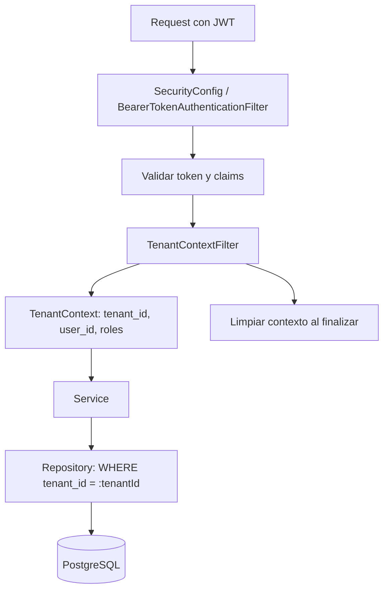

# Multitenancy

## Estado

- **Implementado:** modelo de tenants, `tenant_id` en todas las tablas de negocio, `TenantContext`, filtro desde JWT y consultas filtradas por tenant.
- **Implementado (MVP):** `PLATFORM` como tenant reservado para `PLATFORM_ADMIN`.
- **Pendiente:** Row Level Security (RLS) de PostgreSQL, cifrado por tenant, auditoría cross-tenant de plataforma y caché con claves por tenant.

## Objetivo

Permitir que múltiples instituciones financieras operen en la misma plataforma manteniendo **aislados** sus usuarios, clientes, cuentas, configuraciones y operaciones.

## Modelo

Cada institución es un tenant. La app puede guardar varios tokens, uno por banco, pero **cada JWT pertenece a un único tenant**.

## Componentes implementados

| Componente | Responsabilidad |
|---|---|
| `TenantContext` | ThreadLocal con `tenant_id`, `user_id` y roles. |
| `TenantContextFilter` | Extrae claims del JWT y publica el contexto; limpia al final. |
| `TenantScopedEntity` | Mapea `tenant_id` en entidades de negocio. |
| Repositorios | Métodos `findByIdAndTenantId`, `findAllByTenantId`, búsquedas con `tenant_id`. |
| Servicios | Obtienen el tenant con `TenantContext.requireTenantId()`; nunca de body/path/query. |
| `PLATFORM_ADMIN` | Vive en el tenant reservado `PLATFORM`; puede crear instituciones. |

## Reglas por capa

| Capa | Responsabilidad de aislamiento |
|---|---|
| Controller | No acepta `tenant_id` del cliente para autorización. |
| Service | Exige `TenantContext`; valida pertenencia y reglas de negocio. |
| Repository | Incluye `tenant_id` en todas las consultas de entidades tenant-scoped. |
| Entity/DB | `tenant_id NOT NULL`, FK a `tenants`, índices y unicidad compuesta. |

## Unicidad por tenant

- `UNIQUE(tenant_id, email)` en usuarios.
- `UNIQUE(tenant_id, document_number)` en clientes.
- `UNIQUE(tenant_id, account_number)` en cuentas.
- `UNIQUE(tenant_id, operation, idempotency_key)` en idempotencia.
- `UNIQUE(tenant_id, setting_key)` en configuración.

## Aislamiento en operaciones financieras

- Cuenta origen y destino se buscan con `id + tenant_id`.
- Las transferencias solo permiten cuentas del mismo tenant.
- Los bloqueos pesimistas se toman con el `tenant_id` incluido en la consulta.
- Los eventos de webhook y registros de auditoría se etiquetan con `tenant_id`.

## Riesgos y controles

| Riesgo | Control actual |
|---|---|
| IDOR / acceso cruzado por ID | Búsqueda por `id + tenant_id`; respuesta `404` si no pertenece al tenant. |
| Confianza en `tenant_id` del cliente | El claim del JWT es la única fuente; se ignora cualquier valor del cliente. |
| Consultas sin filtro de tenant | Repositorios acotados y prueba de integración de aislamiento. |
| Fuga de contexto entre hilos | `TenantContext.clear()` en `finally` del filtro. |
| Caché compartida | **Pendiente:** incluir tenant en claves Redis cuando se use caché de negocio. |
| Acceso de plataforma cross-tenant | **Pendiente:** modelo explícito y auditado; en el MVP solo se listan/crean tenants. |

## Pruebas

- `TransactionApiIntegrationTest.tenantCannotReadAccountFromAnotherTenant`: un token del tenant B recibe `404` al leer una cuenta del tenant A.
- El login usa `tenant_code`; un email de otro tenant no autentica.
- **Pendiente:** pruebas de listados, filtros, auditoría y webhooks entre tenants.

## Límites conocidos

- No se usa PostgreSQL RLS en el MVP; el aislamiento es lógico y explícito en código.
- No hay endpoint de administración cross-tenant de datos (solo creación/listado de tenants).
- No hay cifrado de datos por tenant.
