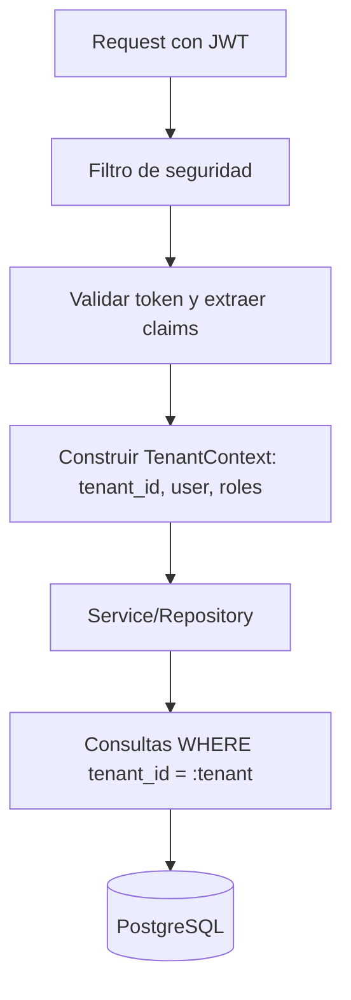

# Multitenancy

## Estado
- **Implementado:** ninguno. No existe modelo de tenants, `tenant_id` en datos, ni resolución de contexto en seguridad/capa de acceso.
- **Propuesto:** aislamiento lógico por `tenant_id` en todas las entidades y operaciones de negocio, con tenant resuelto desde el contexto autenticado.

## Objetivo
Permitir que múltiples instituciones financieras operen en la misma plataforma manteniendo **aislados** sus usuarios, clientes, cuentas, configuraciones y operaciones.

## Principios obligatorios (propuestos)

1. **Fuente de verdad del tenant:** el `tenant_id` efectivo proviene del **contexto autenticado** (JWT/SecurityContext), nunca de un valor enviado libremente por el cliente.
2. **Aislamiento en datos:** todas las tablas de negocio incluyen `tenant_id` y las consultas/mutaciones se filtran por él.
3. **Pertenencia de recursos:** antes de leer/modificar un recurso (cuenta, transacción, cliente, etc.) se valida que pertenezca al tenant del contexto.
4. **Autorización por roles:** además del tenant, se aplican permisos/roles del usuario.
5. **Prevención de acceso cruzado:** respuestas y errores no deben filtrar información de otros tenants.

## Estrategia de resolución (propuesta)

- Un componente de infraestructura (filtro/interceptor) establece el contexto de tenant por solicitud.
- El contexto debe limpiarse al finalizar la solicitud (evitar fugas en hilos reutilizados).
- En operaciones administrativas cross-tenant (si existieran), se requiere un modelo de autorización explícito y separado (pendiente de definición).

## Reglas por capa (propuestas)

| Capa | Responsabilidad de aislamiento |
|---|---|
| Controller | No confiar en `tenant_id` del body/path para autorización; delegar con contexto. |
| Service | Exigir/propagar `tenant_id` del contexto; validar pertenencia y reglas. |
| Repository | Incluir `tenant_id` en todas las consultas de entidades tenant-scoped (métodos derivados o `@Query`). |
| Entity/DB | Columna `tenant_id` (FK), índices compuestos y restricciones de unicidad por tenant cuando aplique. |

## Ejemplos de unicidad por tenant (propuestos)
- `UNIQUE(tenant_id, email)` para usuarios.
- `UNIQUE(tenant_id, account_number)` para cuentas.
- `UNIQUE(tenant_id, idempotency_key, operation)` para idempotencia.

## Riesgos y controles

| Riesgo | Control propuesto |
|---|---|
| IDOR / acceso cruzado por ID | Validar `id + tenant_id` en cada acceso; 404/403 sin revelar existencia |
| Confianza en `tenant_id` del cliente | Ignorar para autorización; usar solo contexto autenticado |
| Consultas sin filtro de tenant | Revisiones de código, pruebas de integración multi-tenant, métodos de repositorio acotados |
| Caché compartida incorrecta | Incluir tenant en claves de caché Redis |
| Datos en webhooks/auditoría | Etiquetar eventos y entregas con `tenant_id` |

## Pruebas de seguridad requeridas (propuestas)
- Acceso con usuario del tenant A a recursos del tenant B debe fallar.
- Tokens sin tenant o con tenant inconsistente deben rechazarse.
- Listados y búsquedas no deben retornar datos de otros tenants.
- Operaciones financieras deben validar origen/destino dentro del mismo tenant (según regla de negocio definida).

## Estado de verificación
No hay implementación; aislamiento multitenant **no verificable** y actualmente **inexistente**. Requiere prioridad alta en la implementación inicial.